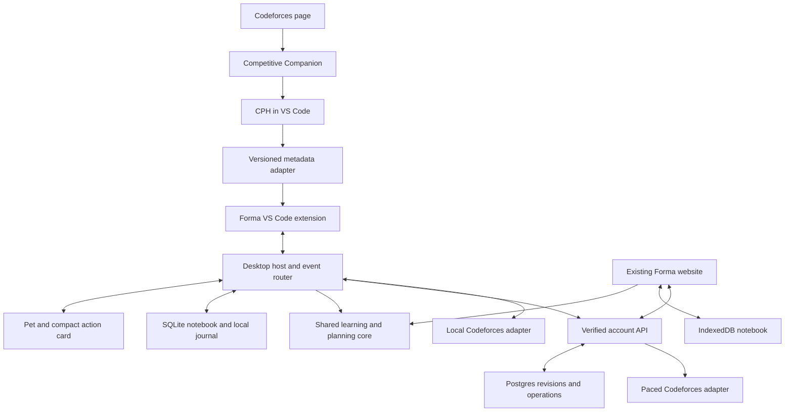

# Forma Companion — Architecture, Product Plan, and Codex Build Prompt

Prepared 19 October 2026  
Repository baseline: jaykelani7-rgb/forma, main, commit 3be4cd4e1fe089613cbe2cba7aac5d94b72754f6  
Status: proposed architecture and delivery plan. The companion described here has not been implemented.

## 1. Product decision

Make a small desktop companion the everyday face of Forma. It follows the user's existing Codeforces → VS Code → CPH → Codeforces submission workflow. The current website remains a complete, independently usable option for tracks, imports, planning, history, account management, and deeper review.

The companion should let someone identify a problem, practise, capture a reflection, and receive a later revision suggestion without opening Forma's website. The website and companion should use the same learning rules and, when connected to the same account, the same durable notebook.

Working product name: Forma Companion. Working character name: Fenn.

The differentiator is the continuity of learning: remembering the problem, the user's own observations, the original outcome, and the next useful revisit across tools. A cute character provides a calm and recognisable interface to that continuity. Do not claim the character concept itself is unprecedented.

“State of the art” is a design goal here, not a benchmark claim. Achieve it through typed integration contracts, evidence provenance, local durability, explicit conflict handling, low interruption, evaluated assistance, and a polished native-feeling interface.

### Daily experience

1. The user opens any Codeforces problem, including one outside Forma's recommendations.
2. CPH/Competitive Companion imports it as usual. Forma associates the problem with the actual solution file when reliable metadata is available.
3. Fenn acknowledges the current problem with a small badge. Tracking is enabled deliberately during setup; identification alone does not create a completed attempt.
4. During work, the pet is mostly still. A click or hotkey opens a compact card for a note, a pause, or the user's earlier memory.
5. CPH remains responsible for local compilation and tests.
6. A Codeforces submission is detected through verified public submission data, or an optional browser hint accelerates its lookup.
7. Once acceptance is observed, the pet offers Independent / Hint / Editorial / Later. Platform acceptance alone never fills in the learning outcome.
8. A saved reflection updates the notebook, learning memory, and revision schedule.
9. On a later suitable day, the pet offers a brief recall or a fresh re-solve. The user can dismiss, defer, or open the original problem.
10. The website reflects synced records when used again. It remains functional without the companion.

## 2. What already exists and should be preserved

The inspected Forma baseline already contains Next.js 16, React 19, strict TypeScript, local IndexedDB workspaces, optional Supabase authentication and revisioned Postgres storage, Codeforces import, Track Studio, Learning Memory, daily plans, Contest Lab, shared curricula, and recovery flows.

Verification performed during this review: 368 unit/integration tests, lint, strict TypeScript, and a Webpack production build passed. Browser execution was blocked by a Chromium download failure in the review environment. These results describe the baseline, not future companion work.

| Existing area | Reuse strategy |
| --- | --- |
| model.ts and validators | Preserve domain identity, outcome vocabulary, backward compatibility, and validated writes |
| learning.ts, memory.ts, practice-state.ts | Extract shared queries and scheduling logic without changing their semantics |
| practice-plan.ts and related types | Use the same recommendations in the pet and Today |
| tracks.ts and shared-tracks.ts | Preserve curriculum membership, independent progress, and sharing privacy |
| contest-lab.ts and contest-learning.ts | Preserve source windows, captured handle, and upsolve relationships |
| concurrency.ts | Preserve three-way merging, revision checks, capacity limits, and recovery |
| cloud-sync.ts and cloud-client.ts | Separate browser-specific dependencies from reusable synchronization logic |
| storage.ts | Keep IndexedDB as the web adapter; add a desktop adapter |
| provider.tsx | Keep React orchestration in the web app; do not transplant this large provider into Electron |
| document/OCR workers and PWA | Retain existing web workflows; desktop document import is not a prerequisite |

### Confirmed integration boundary

Competitive Companion supports custom local receivers for its parsed JSON. CPH imports problems and tests and registers commands including cph.runTestCases. In the upstream CPH checkout inspected at ef8c7a70a7beff150bf5ed5e5ad8c631539a3fd6, activate() returns no public extension API, and problem metadata is stored in .prob files under a configurable location. CPH also contains a CatCompanion UI. These are source observations; the user's installed version has not been checked.

Consequences:

- Do not advertise a guaranteed CPH result subscription.
- A supported command being callable does not mean it returns test results.
- A .prob file proves only the information actually stored in its supported schema; a metadata change does not prove a run passed.
- Make the adapter version-aware, read-only, bounded, and easy to disable.
- Prefer an upstream-supported event API for richer integration when available. Do not silently patch or replace the user's installed CPH.
- Keep a manual Attach Codeforces URL fallback so the whole product does not depend on one external extension.
- Check applicable dependency licences before copying or modifying third-party source. This plan relies on independent adapters, not copying CPH internals.

## 3. Architecture decisions

### Recommended stack

| Layer | Decision | Reason |
| --- | --- | --- |
| Desktop app | Electron, TypeScript, React, Vite | Direct access to desktop windows and a familiar JavaScript toolchain |
| Main desktop target | macOS Apple Silicon first | Fits the user's current environment; Windows follows after platform testing |
| Desktop persistence | SQLite, owned by one service in the desktop process tree | Transactions, local history, durable queues, and efficient indexed lookup |
| Website | Retain current Next.js app and IndexedDB | Preserve the working product and existing users |
| IDE integration | Thin VS Code extension | Observe permitted workspace context and expose small explicit commands |
| Shared domain | Framework-independent TypeScript packages | One implementation of identity, learning, scheduling, and merge rules |
| External contracts | Versioned schemas, with runtime validation | Reject malformed or unsupported messages before state changes |
| UI state | Explicit state machines; use XState if it reduces actual complexity | Make interruption and animation transitions predictable |
| Character rendering | Layered SVG rig initially; renderer interface supports authored Rive assets later | Crisp scalable art with reproducible source; polished animation can evolve separately |
| Account backend | Existing Supabase Auth/Postgres and verified application API | Reuse ownership, revisions, and retry protections |
| Change notifications | Private account-scoped Realtime invalidation, introduced after sync correctness | Prompt clients to fetch durable revisions; never use messages as the sole record |
| Optional intelligence | Provider-neutral server gateway with structured output and evidence retrieval | Keep basic practice usable with AI disabled or unavailable |
| Observability | Local diagnostic ring buffer plus opt-in, redacted operational telemetry | Diagnose failures without recording source code or private note bodies |

Electron is a deliberate recommendation for this project, not a claim that it is the smallest runtime. Measure its cost. If measured idle memory or battery use misses the agreed budget after optimisation, write an architecture decision comparing a Tauri/native shell. Do not maintain two desktop shells in the first release.

Keep deployment as a modular application plus an optional integration worker. Introduce a shared queue/cache when actual concurrency needs it. Kafka, Kubernetes, a vector database, and multiple autonomous agents are not prerequisites.

### Logical topology



The local Codeforces adapter is for local-only mode. Account mode uses the shared backend route. Do not enable both routes as simultaneous pollers for the same companion session. A per-handle leader/lease in the managed service prevents the website and companion from duplicating managed work.

The optional browser extension is a later accelerator. It can provide the current problem or a submission-page hint after explicit site permissions. It is not required to complete the first useful loop, and it cannot authoritatively grant Accepted status.

## 4. Responsibilities and boundaries

### Desktop host

The host owns authenticated integration channels, durable local state, the event router, session policy, synchronization, credential access, lifecycle recovery, and window placement. The renderer gets a narrow allowlisted API.

Keep database work and expensive processing off the renderer thread. Select a SQLite library compatible with the pinned Electron runtime, verify packaging/native-module behavior on Apple Silicon, and keep access behind a storage interface.

Use a single app instance and a single writer for each local workspace. Auxiliary windows must send commands to that writer rather than opening competing writers.

### VS Code extension

Responsibilities:

- Resolve the active permitted solution URI and its verified or user-confirmed problem binding.
- Detect compatible CPH metadata on open/change, with bounded watchers and debouncing.
- Support commands: Attach Problem, Open Companion, Save Thought, Start/Pause Session, Finish and Reflect, Open Prior Memory, and optionally Run CPH Tests.
- Queue small observations locally if the desktop app is temporarily unavailable.
- Report its capability status, adapter version, and reconnect state.
- Respect Workspace Trust and user-selected folders.

Do not upload source files, read unrelated repositories, inspect global keystrokes, or collect the entire editor history by default. An observation that a file was saved is not a test result.

Support local VS Code workspaces first. Remote SSH, WSL, Dev Containers, and Codespaces require a separate transport design because the extension host and desktop can run on different machines. Detect that case and offer a clear limited mode until it is implemented. Do not assume remote localhost is the user's desktop.

### Local transport and pairing

Use a per-user Unix domain socket on macOS/Linux and a named pipe on Windows for desktop ↔ local extension communication. Place endpoints in a per-user application runtime directory with restrictive permissions. Authenticate connections with a scoped pairing credential stored through OS-backed credential storage and VS Code SecretStorage; do not rely only on the local endpoint being obscure.

The protocol includes version negotiation, maximum message size, request/response IDs, bounded queues, acknowledgement after durable receipt, heartbeat, and reconnect backoff. Pairing is explicit once, revocable from settings, and scoped to the app's installation/workspace permissions. Credentials must not be stored in a project repository.

A future custom Competitive Companion receiver is a separate loopback-only import endpoint on its own configurable port. Its ingress may not support the same pairing authentication as the trusted extension channel. Treat every payload there as untrusted suggested problem metadata. It cannot invoke commands, execute code, upload files, or authorize account writes. Apply strict size/rate/identity validation and require an active import context or review before binding.

Do not occupy CPH's existing listener port. Do not require a custom receiver if reading supported CPH metadata already covers the user's workflow.

### Electron boundaries

Load packaged local renderer content. Use context isolation, renderer sandboxing, disabled Node integration, a restrictive CSP, narrow IPC messages with sender and payload checks, and allowlisted external URL opening. Store refresh/pairing secrets with OS-backed secure storage; keep cloud service secrets out of desktop binaries.

Never load arbitrary problem HTML into a privileged renderer. Open Codeforces in the user's browser. Source-derived text, imported metadata, and AI output are data and cannot dispatch executable desktop commands.

## 5. Domain events, identity, and truthful evidence

The design uses typed commands and an append-only local observation journal around the existing revisioned notebook. It does not require rewriting every existing table into event sourcing.

### Event envelope

```ts
type CompanionEvent = {
  eventId: string;
  eventVersion: 1;
  eventType: string;
  deviceId: string;
  workspaceKey: string;
  producer: "vscode" | "desktop" | "codeforces" | "user";
  producerVersion: string;
  occurredAt: string;
  receivedAt: string;
  correlationId: string;
  sourceReference?: string;
  payload: unknown;
};
```

Each event type has its own validated payload schema. Derive account ownership from a verified session, never an arbitrary event field. A workspaceKey routes local records but does not authorize remote access.

Use at-least-once delivery with idempotent application. “Exactly once” is not a transport promise. Retries reuse event/command IDs, and duplicate inserts return the existing result.

### Initial command and event vocabulary

| Kind | Examples | Effect |
| --- | --- | --- |
| Context observations | ProblemIdentified, FileBindingConfirmed, EditorContextChanged | Update context; do not create a solve |
| User session commands | StartSession, PauseSession, ResumeSession, FinishSession | Create or change an explicit tracked session |
| Local test observations | LocalRunObserved, LocalRunCompleted | Only available with a validated result source |
| Platform observations | SubmissionObserved, SubmissionVerdictChanged | Preserve submission ID, handle, actual platform time, and verdict |
| Learning commands | SaveReflection, SaveThought, CompleteRecall | Update learning records through shared domain validation |
| Planning commands | DeferRevision, SkipToday, ChooseNextProblem | Change planning without fabricating practice |
| Lifecycle observations | DeviceSuspended, IntegrationDisconnected, SyncConflict | Reconcile or show status; do not infer ability or outcome |

### Identity and attribution

Canonical identity includes platform, namespace, contest/problem set identifier, and full index, including A1/A2. Gym and ordinary contests remain distinct. Use the existing canonicalisation functions.

A local binding includes the canonical problem key, editor workspace identifier, solution URI, mapping source, mapping confidence, and the relevant integration version. A filename alone is insufficient.

Bind a submission by connected handle, exact problem identity, and an appropriate temporal context. If several sessions or files are plausible, retain the platform observation and ask for a small explicit link instead of assigning credit twice. Preserve Forma's explicit timed/imported-learning linking behavior. Do not silently replace it with heuristic auto-linking.

### Keep independent state dimensions

```ts
type PracticeContext = {
  lifecycle: "ready" | "working" | "paused" | "closed";
  localTests: "unknown" | "running" | "passed" | "failed" | "stale";
  platform: "unknown" | "pending" | "accepted" | "rejected";
  learning: "unrecorded" | "independent" | "hint" | "editorial" | "unsolved";
};
```

Acceptance is an observed verdict and may change after rejudging. Preserve the original observation and apply the newer authoritative verdict. Do not destroy the user's reflection when the platform verdict changes.

If a supported test integration can report the exact source version/run ID, record it. A passing run becomes stale when the solution changes. If the version cannot be established, label the limitation; never present “current code passed” from an old result.

Time in an open editor is not solving time. The default measured record comes from an explicitly started session with pause controls. If optional automatic tracking is added, label its time as tracked work-window duration and retain the user's ability to correct it. Reading, thinking, and switching to Codeforces are not automatically idle. Reconcile sleep/wake and device-clock changes without adding a sleeping night to practice.

## 6. Persistence and synchronization without a rewrite

### Local desktop tables

Suggested initial SQLite tables:

- workspaces: workspace key, local revision, validated canonical notebook JSON, schema metadata.
- observations: immutable event ID, producer, source reference, context, payload, received time.
- applied_commands: idempotency key and resulting local revision.
- outbox: pending sync work, attempt count, next retry, acknowledgement.
- sync_checkpoints: remote base revision, base notebook, pending stable operation.
- file_bindings: local solution mapping; paths remain device-local.
- recoveries: losing proposals and migration backups.
- companion_preferences: position, theme, reduced motion, notification choices.

Apply a notebook-changing command, record its ID, and stage its sync obligation in one local transaction. A crash between UI feedback and remote delivery must leave a replayable durable operation. Show “Saved locally” separately from “Synced”.

Keep the existing 64 MiB supported canonical workspace capacity unless a deliberate migration changes it. Retain limits and failure recovery; do not silently truncate notes or history.

Bound the auxiliary journal separately. Compact acknowledged transient editor-context observations according to an explicit retention policy, while retaining source references needed for learning provenance and pending/recovery operations. Do not save every edit or keystroke. Provide a companion backup/export for device-local preferences and unsynced capture data; do not claim that the existing website backup format already contains those separate tables. Offer the existing canonical notebook export as a distinct interoperable option.

Untimed capture must not fabricate an elapsed duration just to fit an existing Attempt type. Where a platform import exists, reuse the current quick-reflection workflow and its source identity. A new kind of untimed personal learning record requires an explicit domain/validator/backup migration before it can contribute to shared learning; otherwise keep the item as a note/draft until the user completes a supported session or reflection.

### First shipping sync model

Keep the current revisioned workspace snapshot as the authoritative cloud notebook. Extract the existing sync algorithm behind injected storage, locks, credentials, and transport interfaces. Web uses IndexedDB/Web Locks; desktop uses SQLite/single-writer coordination.

Retain:

1. Verified account identity on the server.
2. Server-side revision comparison.
3. Stable operation IDs across uncertain responses.
4. Three-way merge for compatible changes.
5. Explicit same-field conflicts and recovery copies.
6. Separate personal, demo, and verified-account workspaces.
7. Acknowledgement before “Synced” feedback.

Use the outbox to schedule this existing snapshot protocol. Do not build a second event service that independently mutates the same notebook. Local observations are evidence for commands; they are not a competing cloud truth.

Do not claim desktop SQLite and browser IndexedDB are automatically the same database. Seamless web/desktop continuity requires signing into the same configured account. Local-only use remains available, with an explicit import/export migration flow. Explain that local-only copies do not continuously sync in the first release.

The existing browser-origin guard cannot simply be disabled for desktop access. Add an explicit native-client API/transport boundary that authenticates bearer sessions and validates the same payloads, or a narrowly verified native-client path that retains web-origin protections. Desktop requests must not spoof browser ownership. Test both paths against account A/account B and invalid-token cases.

### Schema compatibility

Companion device metadata can initially stay outside the portable notebook. Any new durable learning field requires validator, backup, import, merge, and web-reader updates before companion writes it.

Do not rely on older clients preserving unknown fields: current validators can normalise or strip them. Introduce minimum writer/capability negotiation before adding fields that older writers could erase. Reject incompatible writes with an actionable upgrade state rather than silently losing data.

Move toward record-level/delta sync only when measured snapshot cost justifies it. That later migration needs one coordinated server writer, an explicit old-client policy, backfill verification, per-record concurrency rules, rollback, and export equivalence. Keep it a separate milestone.

### Conflict rules

| Conflict | Resolution |
| --- | --- |
| Different problems edited | Merge by stable identity |
| Same reflection field edited | Explicit conflict, retain both drafts |
| Same observation delivered twice | Deduplicate by event ID/source observation key |
| A verdict changes | Append observation, update projection, keep history |
| Two offline devices start sessions | Preserve both proposals; require resolution under current single-session model |
| Account switches during a request | Bind operation to original account and suppress stale UI feedback |
| Deleted/archived problem receives late evidence | Preserve evidence and apply shared eligibility rules; do not silently unarchive |

Realtime messages should contain revision/invalidation information, not full private notebooks. A reconnect always fetches durable state. Revocation/sign-out closes subscriptions and pairing capabilities are independently revocable.

## 7. Codeforces integration and scale

Use the existing public API adapter as the starting point. Use user.status for submission evidence, not screenshot parsing. Show “waiting for platform confirmation” when the service cannot be reached.

Local-only mode: one desktop process paces all its Codeforces calls, caches public metadata, uses bounded retries, and stops background polling when the relevant session ends. Manual refresh remains available.

Managed account mode:

- Deduplicate work for the same public handle.
- Use one upstream queue/limiter across application processes before horizontal scaling.
- Reuse a cached result across authorized consumers of public handle data.
- Prioritise a user-confirmed submission or an active pending verdict over historical backfill.
- Bound queue age and show stale/fresh timestamps.
- Track upstream failures, timeout rates, queue delay, and cache hit rate.
- Use a durable worker/lease when jobs must continue beyond a request lifetime.
- Redis becomes appropriate here for shared scheduling/coordination; provide a single-process development adapter so initial local work does not require Docker.

The official API limit is at most one request every two seconds. The current Forma adapter uses 2.1-second spacing. A single queue at that spacing supports approximately 28 requests/minute before retries. Polling 100 distinct handles every 15 seconds would require 400 requests/minute and is not a viable promise under that budget.

Therefore:

- Do not promise instant or sub-second acceptance detection via polling.
- Request an immediate queued refresh when the user says “Submitted”.
- Optionally use a browser extension to report a submission ID as a lookup hint; it still requires authoritative verification.
- Allocate the available request budget fairly and adapt cadence to active demand.
- Display the age of the last successful check.
- Do not propose rotating identities/proxies to evade platform limits.

## 8. Pet visual direction: Fenn

### Character concept

An original, compact ivory fox with a broad curved tail, small rounded paws, softly angular ears, dark espresso facial features, and a restrained sage scarf. Use a few sculpted forms with gentle shading. A three-quarter pose should be recognisable at 80–100 logical pixels.

Personality: quietly curious, patient, competent. A brief ear movement or glance is enough during focus. Success is a small satisfied reaction; a rejection is an attentive neutral expression. Avoid guilt, panic, crying, punishment, or dramatic reactions to an unsolved problem.

This is a proposed art direction, not final character artwork. A coding agent can implement the renderer and a high-quality vector prototype. Final illustrated or Rive character polish requires deliberate asset design, consistent rigging, and visual review.

### Visual system

| Element | Direction |
| --- | --- |
| Fur | Warm ivory #F2EBDD |
| Main accents | Muted sage #8B9F8A and deep green #254B3B |
| Face/outline | Espresso #292C27 |
| Light surface | Porcelain #FAF8F3 with restrained warm shadow |
| Ink surface | Charcoal #171918 with ivory text |
| Positive accent | Muted gold #C3A56C, used sparingly |
| Typography | Reuse Geist; small Instrument Serif accents only where legible |
| Surface geometry | 18–22 px card radius; consistent spacing; crisp controls |
| Default size | Pet about 88–112 logical px; compact content-driven window |
| Expanded card | About 320–360 px wide, content-sized to available display area |
| Tone | Short, calm, specific sentences |

Do not rely on color alone for status. Verify contrast and large-text layouts against actual backgrounds.

### Three presentation modes

1. **Pet only:** a small unobtrusive character and an optional tiny status marker.
2. **Glance card:** current problem, save/sync status, and one relevant next action.
3. **Action card:** note, reflection, recall, or next-problem choice, with explicit close and keyboard access.

The full website is available through Open Forma. Do not compress the entire website sidebar into the pet card.

### Animation specification

| State | Motion | Trigger and duration |
| --- | --- | --- |
| Idle | Very subtle breathing, occasional blink | Low frequency; no constant roaming |
| Focus | Still seated posture with a soft glance | Active session; movement reduced |
| Import/context ready | Brief ear lift and head turn | Once after confirmed context |
| Local tests running | Small attentive posture | Only from a supported run signal |
| Local tests passed | Small nod | Distinct from platform acceptance |
| Submission pending | Patient seated pose | No rapid looping spinner |
| Accepted | Brief tail curl and small bounce | Once per newly observed acceptance |
| Needs attention | Neutral head tilt with a small badge | User-actionable error; not blame |
| Reflection saved | Short relaxed nod | Only after durable save |
| Recall available | Quiet bookmark-like badge | Offered at a suitable moment |
| Paused/asleep | Curled or resting pose | User pause / sleep policy |
| Offline | Neutral state with accessible status | No permanent alarm animation |

Separate semantic state from animation. The learning system emits a small presentation model; the renderer selects art/motion. Changing the mascot must not change scheduling or storage.

Layer source assets as body, ears, eyes, tail, paws, scarf, shadow, and accessory. Keep anchors and baseline consistent. Preserve editable source and the asset licence/creation history. For generated raster concept art, use it as a reference or an explicitly prepared sprite pipeline; do not warp a single flat image and call it a completed animation system.

Use SVG/CSS transforms for the initial rig. Add a Rive renderer only with a real authored, checked-in asset and documented state inputs. Do not fabricate a .riv file or introduce a paid authoring dependency as a hidden requirement.

### Desktop behavior

- Dragging uses a defined handle or pet body area.
- Remember per-display position in logical coordinates; clamp it back to the work area after monitor changes.
- Keep the hitbox tight. Transparent padding must not block code, browser links, or terminal controls.
- Use platform-supported click-through behavior cautiously and test it; provide a simple compact-window fallback.
- Do not steal keyboard focus when a status changes.
- Default to hiding or becoming quiet in fullscreen presentation/game contexts where reliable platform detection is available; expose a manual toggle.
- Respect sleep/wake, display scale, Spaces, menu bar/Dock changes, and reduced motion.
- Sound is off by default.
- Global shortcut is configurable and conflict-checked.
- Always provide a tray/menu-bar recovery command if the pet becomes hidden or off-screen.
- The desktop must work from packaged local assets when the network is absent.

Transparency, always-on-top behavior, and fullscreen placement vary by OS/window manager. Verify on actual target systems; do not generalise one platform's result.

## 9. Useful features and interruption policy

### Core features

**Automatic context with explicit ownership:** recognize a supported problem/file pair, show the evidence for the binding, and allow correction.

**One-click reflection:** after acceptance or explicit Finish, record a user-selected outcome and optional takeaway. Later dismisses without falsely marking independent.

**Resume memory:** restore the user's saved last thought when returning to an unfinished problem. AI-generated summaries, if enabled, are labelled and editable.

**Recall in the workflow:** offer Explain invariant, Complexity/edge cases, or Re-solve from a blank file. Never overwrite the existing solution; create a separate scratch file only after the user chooses that action.

**Personal mistake reminders:** retrieve the user's previously recorded mistakes and their supporting records. Do not infer a psychological trait or claim a code bug without evidence.

**Contextual next problem:** use the existing deterministic planner. A user can always choose something else or dismiss the suggestion.

**Portable progress:** the website stays available for track editing, document import, shared curriculum management, and historical analysis.

### Interruption policy

The policy engine receives semantic events, user preferences, current session mode, and recent prompt history. It decides whether to show a badge, a compact card, or nothing.

Default rules:

- Never reveal problem tags, hints, editorials, or old solutions automatically.
- No automatic AI coaching during a live contest; explicit practice/contest mode controls assistance.
- At most one nonessential proactive suggestion in a 30-minute window, and none while an input field is actively being edited.
- The acceptance event can set a quiet badge; it does not open a blocking modal.
- Only actionable storage/auth failures receive persistent status.
- Snooze for the session, for the day, or indefinitely.
- No missed-day punishment, streak loss animation, or pet “health” linked to coding frequency.
- Celebrate an independently completed revisit using confirmed learning history.
- All actions remain accessible without animation and without a mouse.

## 10. Optional intelligence architecture

Ship the dependable practice loop before adding AI. The companion should remain useful with no model key and no AI subscription.

Use an optional server-side provider adapter with timeouts, cancellation, request quotas, and schema-validated responses. Keep provider secrets off the desktop. Do not train a custom foundation model as an initial requirement.

### Context construction

1. Resolve current canonical problem, current user intent, and allowed assistance mode.
2. Retrieve explicitly recorded notes and outcomes for the same problem.
3. Retrieve relevant prior records using tags, canonical identities, and local lexical search.
4. Include only a bounded number of relevant records with their record IDs and dates.
5. Add selected source code only after the user explicitly enables that action.
6. Ask the model for a constrained output: summary, recall question, or user-requested hint.
7. Validate the response and show evidence links where it makes factual claims about history.
8. Require explicit confirmation before model output changes a durable reflection or schedule.

A vector index is an optional later optimisation if retrieval evaluation shows a measurable benefit over lexical/tag matching. Keep a retrieval test set first.

### Permitted intelligence tasks

- Turn a user-selected rough note into a clearer editable takeaway.
- Generate a recall question grounded in a saved explanation.
- Summarise confirmed prior mistakes with source references.
- Offer a progressive hint only after the user asks and the assistance mode permits it.
- Explain a reported compiler error from deliberately supplied content.

Do not let an LLM assign independent-solve credit, diagnose inactivity as being stuck, declare acceptance, execute code, alter records silently, or control desktop input.

Treat problem text, code comments, imported notes, and retrieved records as untrusted content. They cannot override system policy or request data exfiltration. Keep tools allowlisted and separate generation from mutation.

### Evaluation before release

Use a small versioned set of representative histories and requests. Measure groundedness, correct source references, spoiler leakage, inappropriate contest assistance, hallucinated history, response latency, cost per request, and refusal/fallback quality. Compare against simple deterministic prompts. Release only the tasks that improve the experience.

## 11. Repository layout and migration sequence

Start by adding workspaces without relocating the working Next.js app. Preserve root scripts and deployment assumptions until tested.

| Path | Purpose |
| --- | --- |
| src/app, src/components | Existing web app |
| packages/core | Pure domain models, identity, learning, planning, validation |
| packages/contracts | Versioned external events/commands and protocol schemas |
| packages/sync | Storage-independent revision and recovery coordination |
| packages/pet-ui | Character rendering contract, art assets, compact cards, shared tokens |
| packages/integrations | CPH/Competitive Companion/Codeforces adapters with fixtures |
| apps/desktop | Electron main/preload/renderer, SQLite adapter, lifecycle, packaging |
| apps/vscode-extension | Thin IDE integration and local bridge client |
| docs/companion | Decisions, protocol, migration, visual specifications, verification |

Do not duplicate existing rules into packages/core and then let the copies diverge. Move or re-export progressively, with the website consuming the extracted functions immediately.

Use an account/storage interface rather than imports from IndexedDB or Electron inside core. Avoid DOM, window, localStorage, filesystem, and React dependencies in pure modules. Keep the existing dependency manager unless a concrete build limitation justifies changing it.

Add a browser extension only after the first end-to-end loop is proven and a measured gap justifies it.

## 12. Delivery phases and gates

The schedule is an estimate for one developer with AI coding assistance; it is not a promise. Native packaging, animation quality, and upstream integration surprises can change it. A credible first useful build may take 2–4 focused weeks; a polished public beta may take roughly 8–12 weeks. A beginner working around classes should expect longer.

| Phase | Scope | Completion evidence |
| --- | --- | --- |
| 0 — Baseline and feasibility | Inventory repo, regression baseline, inspect installed CPH, metadata mapping, macOS overlay spike, SQLite packaging spike | Recorded capabilities and limitations; no fabricated APIs |
| 1 — Shared foundations | Extract core/contracts/sync boundaries; preserve web behavior | Existing unit/build checks pass; web smoke flows still work |
| 2 — Aesthetic desktop slice | Fenn source assets, pet window, card, drag, tray, hotkey, local SQLite, manual problem binding, note/reflection | Packaged local app completes a real manual practice loop offline |
| 3 — Real workflow integration | Thin extension, pairing, CPH metadata adapter, source binding, queues, Codeforces evidence | CF import → coding → submission evidence → reflection works without website |
| 4 — Account continuity | Desktop sync adapter, native API boundary, conflicts, schema negotiation, web parity | Two devices/clients, retry, logout, simultaneous edit, restore verified |
| 5 — Recall and memory | Existing planner in pet, resume thought, recall, blank re-solve action, interruption policy | Useful revision offered without spoiling or fabricating learning |
| 6 — Optional intelligence | Bounded retrieval, source links, model gateway, evaluated tasks | Evaluation set and failure modes pass with AI-off fallback |
| 7 — Polish and distribution | Final animation review, accessibility, battery work, crash recovery, signing/update design, Windows testing | Signed builds when credentials exist; honest platform support matrix |

Native pet quality is part of Phase 2 and refined throughout. Do not postpone the character until after shipping a generic dashboard.

Each phase should end with a runnable, reviewable result. Keep later phases visible in a task ledger rather than pretending a large master prompt produces production readiness in one pass.

### Minimal valuable release

The first release includes a real desktop pet, a real supported file/problem binding, explicit session or untimed practice capture, Codeforces evidence, one-click reflection, local recovery, and revision offers. It may ship without automatic CPH result reporting if the installed version lacks a reliable result channel. Explain that capability clearly while retaining CPH's normal workflow.

## 13. Verification and release criteria

### Functional and failure tests

- Website add/edit/session/reflection/revision/backup flows remain intact.
- Track Studio imports and shared-track privacy remain intact.
- Contest Lab evidence and upsolve behavior remain intact.
- Context detection handles reused filenames, renamed files, different folders, Gym, A1/A2, and multiple VS Code windows.
- Unsupported or malformed CPH metadata falls back safely.
- Duplicate imports and reconnect retries create one logical observation/command.
- An old passing test does not describe newly edited source.
- Wrong-handle or ambiguous submissions never gain automatic learning credit.
- Rejudging updates platform evidence while preserving user reflections.
- A crash after local commit and before cloud acknowledgement recovers.
- A network timeout after a remote commit replays the same operation.
- Same-field conflicts preserve both versions.
- Account switch/logout during a delayed callback cannot expose another workspace.
- Two offline sessions do not get silently merged into an invented duration.
- Clock changes and suspend/resume do not inflate time.
- Malformed IPC, oversize payloads, arbitrary paths, and external URLs cannot invoke privileged actions.
- Old-client compatibility is tested before new portable fields ship.

### Visual and interaction tests

Inspect actual rendered frames and short motion captures on light, dark, bright wallpaper, and a busy editor background. Check 1×/2× display scaling, Large text, keyboard-only use, reduced motion, and monitor changes.

Verify the pet silhouette at 80, 96, and 112 logical pixels. Check tail/ear anchor stability, consistent proportions, baseline contact, clipping, shadows, alpha edges, and loop seams. Review every semantic state, not only the idle pose.

Test underlying editor controls beside transparent edges, focus retention while typing, hotkey conflicts, hidden-window recovery, fullscreen behavior, and menu-bar/tray access. Never claim macOS behavior was verified from Linux screenshots.

### Provisional performance budgets

These are release targets to measure on a named reference machine, not established performance facts.

| Metric | Initial target |
| --- | --- |
| Local click-to-card response | p95 below 150 ms |
| Local note-save acknowledgement | p95 below 200 ms for a representative notebook |
| Idle CPU | Average below 1% of one core over a defined 5-minute idle scenario |
| Idle total desktop memory | Aim below 250 MiB; investigate above 300 MiB on the reference machine |
| Animation | 30 fps during short reactions; static/low-frequency idle; stop when hidden |
| Cloud verdict latency | Report queue and upstream freshness; no guaranteed instant result |
| Idle network | No continuous submission polling without an active reason |
| Startup | Measure cold and warm separately; establish a target after native spike |

Use event-driven updates and bounded watchers. Do not continuously scan source files or run a hidden 60 fps animation loop. Performance regressions are a release issue for a persistent companion.

### Distribution

Use pinned supported runtime versions and a reproducible lockfile. Build/test on the actual target OS. macOS distribution needs a signing/notarisation path; Windows needs its own packaging and signing plan. Credentials and paid accounts are separate prerequisites, not something a coding prompt can invent.

Prepare release artifacts and configuration locally. Do not publish extensions, deploy services, send data to a new third party, or purchase services without explicit authorization. A local unsigned development build must be labelled as such.

## 14. Adoption and success measures

The principal outcome is useful practice completed through the companion without a compulsory website visit.

Opt-in metrics should be coarse and redacted:

- First problem successfully bound.
- First reflection saved from the pet.
- Fraction of identified problems correctly associated without correction.
- Reflections captured without opening the website.
- Revisit offers accepted, deferred, and muted.
- Recovery success after disconnect/restart.
- Sync conflicts and rejected incompatible writes.
- CPU/memory/battery regressions.
- Whether users keep the pet visible after a week.

Do not collect source text, raw file paths, code edits, problem notes, or account tokens as analytics. User interviews should ask whether the pet helps them resume and remember, not merely whether they like the animation.

## 15. Decisions to retain

1. Primary everyday interface: desktop pet.
2. Existing website: fully supported alternative and deep-review surface.
3. Thin VS Code extension supplies trustworthy context.
4. CPH continues compiling/testing; result integration depends on actual capabilities.
5. Shared domain logic prevents web/desktop learning divergence.
6. SQLite desktop and IndexedDB web are separate stores with an explicit account sync boundary.
7. Existing revisioned notebook remains authoritative in the first release.
8. Local journal/outbox provides reliable delivery without a second conflicting backend.
9. Independent solve, local test success, and platform acceptance remain separate.
10. AI is optional, bounded, evaluated, and subordinate to evidence.
11. Fenn uses original consistent art, restrained motion, and no guilt mechanics.
12. Native behavior and performance are measured on real target machines.

## 16. Primary sources and review evidence

Sources support integration capabilities. The product design, architecture choices, estimates, and performance targets above are recommendations.

- [S1] Forma baseline: https://github.com/jaykelani7-rgb/forma/tree/3be4cd4e1fe089613cbe2cba7aac5d94b72754f6
- [S2] CPH source inspected locally: https://github.com/agrawal-d/cph/tree/ef8c7a70a7beff150bf5ed5e5ad8c631539a3fd6 — extension.ts, parser.ts, types.ts, runTestCases.ts, companion.ts, and webview/frontend/CatCompanion.tsx.
- [S3] Competitive Companion custom-tool protocol: https://github.com/jmerle/competitive-companion#custom-tools
- [S4] VS Code workbench APIs: https://code.visualstudio.com/api/extension-capabilities/extending-workbench
- [S5] VS Code Workspace Trust: https://code.visualstudio.com/api/extension-guides/workspace-trust
- [S6] VS Code remote extension constraints: https://code.visualstudio.com/api/advanced-topics/remote-extensions
- [S7] Electron security: https://www.electronjs.org/docs/latest/tutorial/security/
- [S8] Electron windows: https://www.electronjs.org/docs/latest/api/browser-window
- [S9] Electron secure storage: https://www.electronjs.org/docs/latest/api/safe-storage
- [S10] Supabase Realtime authorization: https://supabase.com/docs/guides/realtime/authorization
- [S11] Supabase database change subscriptions: https://supabase.com/docs/guides/realtime/subscribing-to-database-changes
- [S12] Codeforces API limits and methods: https://codeforces.com/apiHelp and https://codeforces.com/apiHelp/methods
- [S13] Rive runtime/state-machine capability: https://rive.app/docs and https://github.com/rive-app/rive-wasm

---

# Copy-ready Codex implementation prompt

Copy everything in this section into Codex with the Forma repository open. Keep this blueprint available as project context. This prompt requests implementation; the present planning conversation has not executed it.

You are working on my existing repository: https://github.com/jaykelani7-rgb/forma.

Build Forma Companion on top of the existing product. The primary everyday experience must be a beautiful small desktop pet that fits my real workflow: read a Codeforces problem, code in VS Code, test using CPH, and then submit to Codeforces. Keep the current Forma website fully functional as an alternative for all its existing workflows. I should be able to practise, reflect, and receive revision suggestions without visiting the website.

Work from the actual checkout. The planning baseline was main at 3be4cd4, but inspect the current repository and current AGENTS.md before making changes. Follow the repository's Next.js version-specific documentation requirements. Preserve unrelated work. Use the accompanying Forma Companion blueprint as the architectural and design specification; report any necessary deviation with evidence.

## A. Outcome and workflow

Implement a real desktop application, a thin VS Code extension, shared learning logic, and explicit synchronization with the existing website/account system.

The product must:
- Identify a supported Codeforces problem and bind it to the actual solution file, with a manual URL fallback.
- Stay unobtrusive while I work.
- Let me save a thought, start/pause a session, finish, or open my prior memory from the pet.
- Observe Codeforces submissions for the connected handle and exact problem without inventing results.
- Offer Independent / Hint / Editorial / Later after an observed acceptance or deliberate finish.
- Save the reflection through the existing learning rules and schedule future recall/re-solving.
- Offer useful later revision directly from the pet.
- Preserve local durability when the network or integrations fail.
- Keep existing web users, data, imports, shared tracks, and Contest Lab functioning.

Do not turn the pet into a miniature dashboard with dozens of controls. Build a small character, a compact glance card, and a contextual action card.

## B. Architecture

Use Electron + TypeScript + React for the desktop, macOS Apple Silicon first. Keep the current Next.js website and IndexedDB. Add SQLite for the desktop. Preserve the existing dependency manager and root web commands initially.

Extract framework-independent packages progressively:
- packages/core for identity, learning, planning, scheduling, and validators.
- packages/contracts for versioned integration commands/events and runtime schemas.
- packages/sync for storage-independent revisioned synchronization and recovery.
- packages/pet-ui for art, animation contracts, compact cards, and design tokens.
- packages/integrations for tested CPH/Competitive Companion/Codeforces adapters.
- apps/desktop for main/preload/renderer, persistence, windows, packaging.
- apps/vscode-extension for the IDE integration.

Do not duplicate the learning algorithms. The website must consume the extracted core as extraction progresses. Do not move the entire app or change its storage scheme in one large rewrite.

Use a modular architecture with typed ports/adapters, explicit state machines, a local observation journal, and a transactional outbox. Keep the existing revisioned cloud notebook authoritative for the first shipping version. Do not introduce a second cloud event writer that races the existing workspace endpoint.

Adapt existing cloud synchronization to injected storage/lock/credential interfaces. Retain server-side identity verification, compare-and-swap revisions, stable operation IDs, compatible three-way merges, recovery copies, and account isolation. SQLite and browser IndexedDB are separate stores; same-account sync joins them. Local-only mode must work and clearly describe its import/export continuity.

Handle native-client authorization explicitly without disabling the website's origin checks. Gate incompatible writers before adding new portable fields that old validators could erase.

## C. Integration truthfulness

First inspect the installed/current CPH version. Do not assume a public test-result API. The reviewed upstream CPH activate() returned no public extension API; it had .prob metadata, commands, and an existing cat UI.

Implement a bounded, read-only, version-aware metadata adapter where supported. Never modify CPH files or hijack its listener port. Detect unsupported schemas and fall back to Attach Problem. Do not treat command completion, file saves, metadata changes, or sample success as proof of Codeforces acceptance.

The trusted desktop/extension channel should use a per-user Unix socket or Windows named pipe with pairing authentication, version negotiation, acknowledgements, limits, and backoff. Store pairing secrets securely. The extension must respect Workspace Trust and selected folders, and explain limited support for remote extension hosts.

If a Competitive Companion custom receiver is needed, isolate its untrusted loopback ingress from privileged commands. It may suggest validated problem metadata, never execute code or authorize account access.

Use the existing Codeforces adapter. Local-only and managed-account modes must have explicit polling ownership. Preserve request pacing, deduplicate handle refreshes, stop idle polling, and show freshness. Shared deployments require shared upstream coordination. Do not promise instant verdicts or evade API limits.

## D. Evidence and data invariants

Keep these independent:
- lifecycle: ready/working/paused/closed;
- local tests: unknown/running/passed/failed/stale;
- platform verdict: unknown/pending/accepted/rejected;
- learning outcome: unrecorded/independent/hint/editorial/unsolved.

Only user-confirmed reflection gives independent-learning credit. Keep Gym, contest namespaces, and split indices distinct. Preserve explicit timed/imported attempt linking. Ambiguous submissions remain unassigned until resolved.

Events have stable IDs, schema versions, producer/version, device/workspace scope, source references, occurred/received timestamps, and correlation IDs. Delivery is at least once; application is idempotent. Commit notebook mutations, command IDs, and sync obligations transactionally. Never announce success before local durability.

A local passing test is stale after source changes. Codeforces rejudging updates platform evidence without deleting reflections. Editor dwell time is not solving time. Handle sleep/wake, clock changes, conflicting offline sessions, account switches, and delayed callbacks without losing records or inventing duration.

Do not upload source code or unrelated workspace content by default.

## E. Pet art direction

Create an original character called Fenn: a small warm-ivory fox, broad curved tail, rounded paws, softly angular ears, espresso eyes, and a restrained sage scarf. Aim for a refined editorial mascot with gentle sculpted shading, crisp silhouette, and excellent legibility at 80–112 logical pixels.

Palette: ivory #F2EBDD, sage #8B9F8A, deep green #254B3B, espresso #292C27, porcelain #FAF8F3, charcoal #171918, muted gold #C3A56C. Reuse Geist and use Instrument Serif sparingly. Respect Light and Ink modes.

Keep editable, consistently anchored layered assets: body, tail, ears, eyes, paws, scarf, and shadow. Implement a polished SVG rig initially with a renderer abstraction. Use Rive only with a real authored asset and documented inputs. Do not fabricate asset files or disguise a rough placeholder as final artwork. If image generation is available, use it for concept/reference work and preserve a coherent final animation pipeline.

Build idle, focus, context-ready, tests-running, local-tests-passed, submission-pending, accepted, needs-attention, reflection-saved, recall-available, and paused states. Motion should be short, subtle, and semantic. No constant roaming, loud effects, guilt, hunger, punishment, or exaggerated failure reactions. Sound off by default; reduced-motion support is required.

The default window shows the pet and minimal status. Expanded cards should be approximately 320–360 logical pixels wide with clear text, restrained shadows, balanced spacing, and one primary action. Make the character feel integrated with the interface.

Implement tight hitboxes, drag positioning, work-area clamping, display scaling, tray/menu-bar recovery, a configurable shortcut, and focus-safe opening. Transparent pixels must not obstruct coding. Verify actual macOS behavior; show limitations honestly where fullscreen/click-through differs by platform.

## F. Attention and optional AI

Use an explicit interruption policy:
- stay quiet during active work;
- use a badge for acceptance and revision availability;
- do not open blocking modals automatically;
- expose snooze/mute;
- do not reveal hints, tags, editorials, or old solutions without a deliberate request;
- avoid proactive assistance in contest mode.

Reuse deterministic planning first. The core loop must function with AI disabled.

Later add a provider-neutral gateway for user-requested note polishing, grounded memory summaries, recall questions, and progressive hints. Retrieve bounded relevant records and retain their IDs. Mark generated text as editable suggestions. Obtain explicit opt-in for selected source-code analysis. Validate outputs, handle timeouts, and test spoiler leakage and hallucinated history. AI must not execute code or silently alter learning records.

## G. Delivery order

Maintain docs/companion/implementation-status.md and record completed, pending, blocked, and verified work.

Phase 0: repository baseline and capability spikes for CPH, native windows, local transport, and SQLite packaging.
Phase 1: shared core/contracts/sync extraction with the website preserved.
Phase 2: an attractive runnable desktop slice with real local storage, manual binding, session/note/reflection, tray, and window behavior.
Phase 3: real VS Code integration and Codeforces evidence.
Phase 4: account synchronization and web parity, including conflicts and schema compatibility.
Phase 5: recall, resume memory, and interruption policy.
Phase 6: optional evaluated intelligence.
Phase 7: visual refinement, performance, accessibility, distribution, and additional OS support.

Start implementing the earliest unfinished phase and continue through a runnable end-to-end slice. Use sensible defaults rather than asking about routine choices. If external credentials, installed applications, native OS access, or art tools are unavailable, implement and test the local boundary with clearly labelled fixtures and document the remaining real-world gate. Never claim a mocked integration, unsigned artifact, or untested platform is production-ready.

## H. Verification and delivery

Keep the existing tests green and add meaningful tests for new boundaries:
- canonical problem/file mapping;
- unsupported metadata;
- duplicate event delivery;
- missing results and stale passing tests;
- verdict attribution and rejudging;
- crash recovery and offline queues;
- lost cloud acknowledgements and conflicts;
- account switches during pending work;
- incompatible clients;
- clock/sleep behavior;
- untrusted IPC/input;
- web regression workflows.

Inspect screenshots and short animation captures for every pet state at multiple scales and both themes. Test keyboard-only/reduced-motion operation, focus retention, monitor changes, transparent hit targets, and hidden-window recovery on actual target OSes.

Measure idle CPU/memory/network usage. Initial targets: p95 local card response below 150 ms, representative local save below 200 ms, idle CPU below 1% of one core, and idle desktop memory around or below 250 MiB. These are targets to report against, not values to claim without measurement. Stop rendering while hidden and avoid continuous file scans.

Use context isolation, sandboxing, disabled renderer Node integration, narrow IPC, packaged local content, and OS-backed credential storage.

Prepare local builds and documentation. Do not deploy, publish an extension, purchase services, or release signed updates without explicit authorization. Finish each milestone with what works, how to run it, exact verification performed, remaining limitations, and the next milestone. Preserve the existing website throughout.

